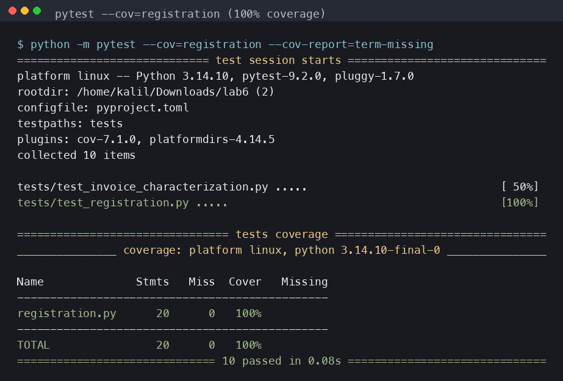

# Lab 6: TDD, BDD & Refactoring

## Part A — TDD & Task A1 (Coverage Report)

TDD cycles for `registration.py` are recorded in Git history (`test: rule 1` through `test: rule 4`, followed by `43d6275` for the fifth test `test_drop_unregistered_course`).



```text
$ python -m pytest --cov=registration --cov-report=term-missing
Name              Stmts   Miss  Cover   Missing
-----------------------------------------------
registration.py      20      0   100%
-----------------------------------------------
TOTAL                20      0   100%
```

**Does 100% coverage prove the code is correct?**

No—100% statement coverage only proves that every line was executed at least once, not that all edge cases, input combinations, missing requirements, or faulty assertions and business logic were verified.

---

## Part B — BDD & Task B1 (`behave` Output)

`features/registration.feature` includes `Scenario: Drop a registered course`, wired to `features/steps/registration_steps.py`.

```text
$ python -m behave
1 feature passed, 0 failed, 0 skipped
7 scenarios passed, 0 failed, 0 skipped
28 steps passed, 0 failed, 0 skipped
```

---

## Part C — Refactoring Legacy Code with SOLID

### Task C1 — Completed Smells Table (`legacy_invoice.py`)

| Smell | Where | Principle it breaks |
| --- | --- | --- |
| Long `if/elif` chain on `kind` | Loop body (`if kind == ...`) and after loop (`if kind == "international"`) | **OCP**: adding a new student type requires editing `make_invoice` in two places |
| Mixed responsibilities (calculation, formatting, disk I/O, and printing) | Entire `make_invoice` function (`open`, `write`, `print`, and fee calculation) | **SRP & DIP**: multiple reasons to change (SRP), and the function depends directly on concrete disk/stdout I/O instead of an injected writer abstraction (DIP) |
| Magic numbers (`1200`, `0.5`, `2000`, `5000`) and duplicated base rate | Inside the `if/elif` branches and service-fee check | **Readability / DRY**: unnamed constants hide intent and duplicate `1200` across regular and scholarship branches |
| Feature Envy / unnecessary per-course loop | `for code in student.courses: h = student.courses[code]` | **Information Expert / Encapsulation**: `make_invoice` accesses `student.courses` directly instead of using `student.total_hours` |
| File opened manually without `with` | `f = open(...); f.write(text); f.close()` | **Resource safety**: if `f.write(text)` raises an exception, `f.close()` is skipped and the file handle leaks |

### Task C2 — Refactored `invoice.py`, `SiblingPolicy`, and Before/After Measurements

- Added characterization tests in `tests/test_invoice_characterization.py` for `"regular"` (`7200`), `"scholarship"` (`3600`), `"international"` (`17000`), and injected `FakeWriter`.
- Refactored `invoice.py` using `FeePolicy` (`ABC`), `RegularPolicy`, `DiscountedPolicy`, `ScholarshipPolicy`, `InternationalPolicy`, `POLICIES`, and `FileWriter`.
- Added `SiblingPolicy(DiscountedPolicy)` with `DISCOUNT = 0.25` (25% off regular fee) test-first (`test_sibling_policy_25_percent_discount` expecting `5400`) without modifying `make_invoice`.

| Measure | Before (`legacy_invoice.py`) | After (`invoice.py`) |
| --- | --- | --- |
| Cyclomatic complexity of `make_invoice` | `6` | `1` |
| Tests passing (`pytest`) | `0` (before characterization tests) | `10` (`5` registration + `5` invoice tests) |
| Add a `"sibling"` discount type | Edit two `if/elif` chains in `make_invoice` | Add `SiblingPolicy` class + `"sibling"` entry in `POLICIES` |
| Test without writing files | Not possible | Yes, with injected `FakeWriter` |
